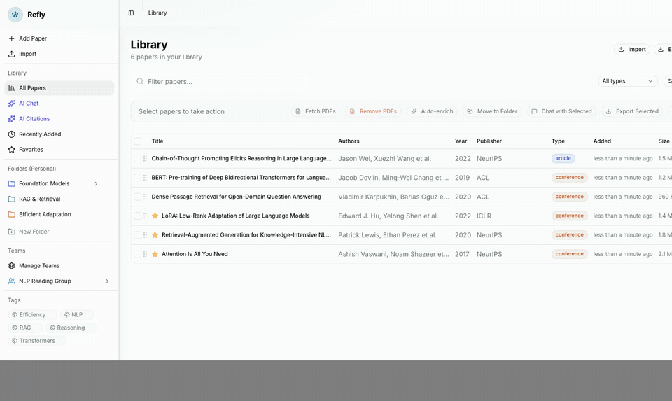
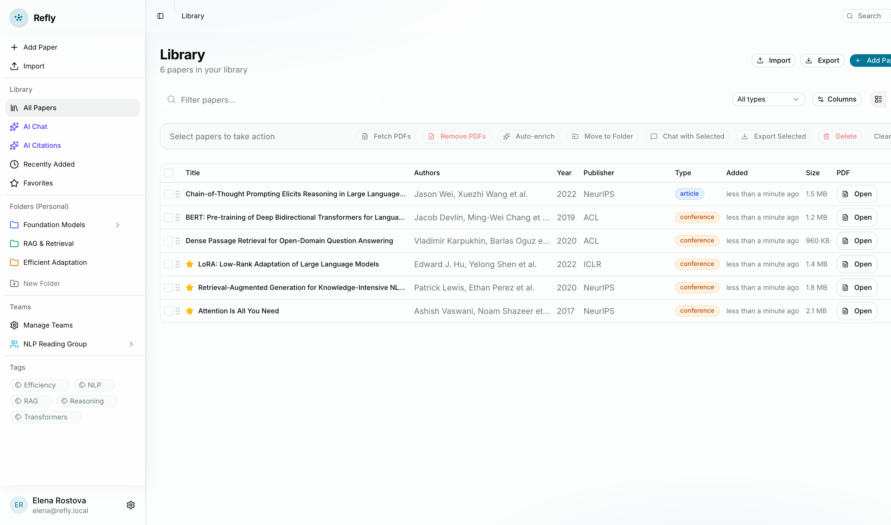
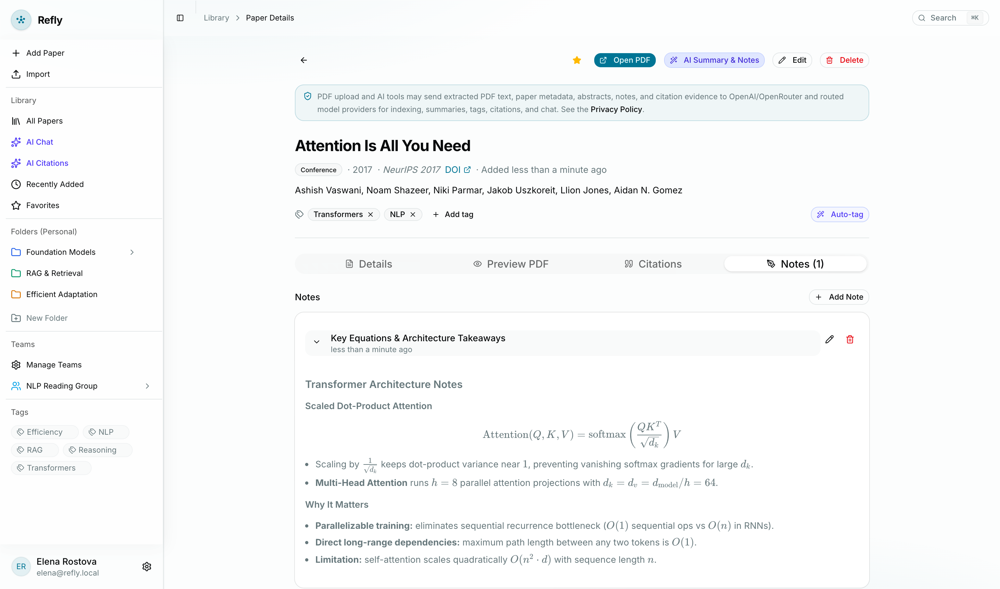
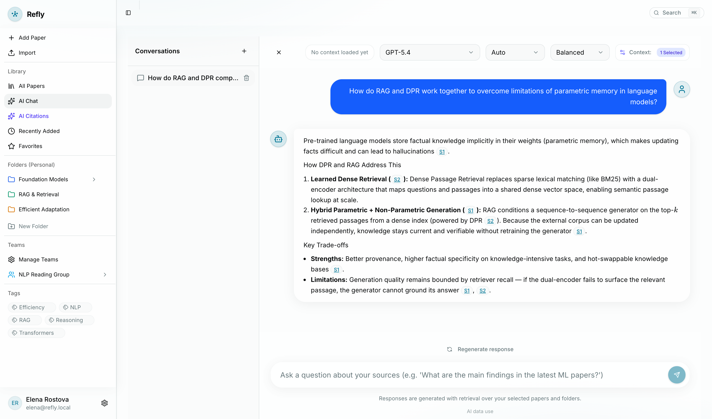
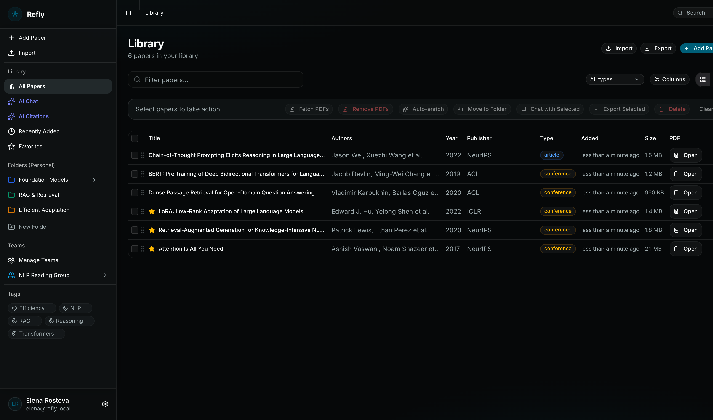
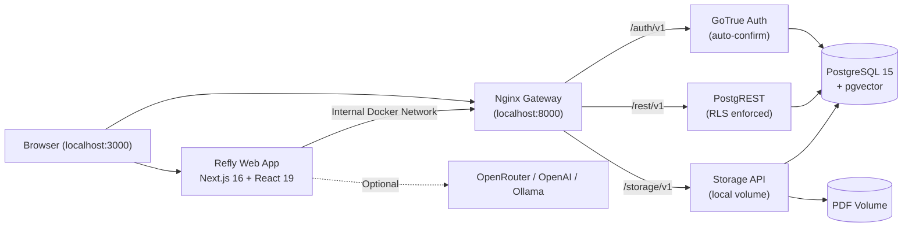

<div align="center">


# Refly

**An open-source, self-hosted AI research workspace for organizing papers, PDFs, notes, and citations locally.**

[](LICENSE)
[](https://nextjs.org/)
[](https://react.dev/)
[](https://www.typescriptlang.org/)
[](docker-compose.yml)
[](https://github.com/pgvector/pgvector)

[Preview](#-preview) · [Quick Start](#-quick-start-docker) · [Features](#-features) · [AI Setup](#-enabling-ai-features-optional) · [Architecture](#-architecture) · [Local Dev](#-local-development) · [Contributing](CONTRIBUTING.md)

</div>

---

Refly is an open-source hobby project built to bring paper management, PDF reading, Markdown + KaTeX research notes, citation formatting, and grounded RAG AI chat into one calm, local-first workspace.

Everything runs on your own machine via Docker Compose — **no cloud accounts, no subscriptions, and no paywalls**. Your papers, PDFs, notes, and vector embeddings stay in your local Docker volumes, and AI keys are completely optional.

---

## Preview

<div align="center">
  
</div>

<br />

<table>
  <tr>
    <td width="50%">
      
      <p align="center"><sub><b>Paper Library</b> — nested folders, tags, teams, and local PDFs</sub></p>
    </td>
    <td width="50%">
      
      <p align="center"><sub><b>Paper Details &amp; Notes</b> — Markdown with KaTeX math &amp; citations</sub></p>
    </td>
  </tr>
  <tr>
    <td width="50%">
      
      <p align="center"><sub><b>Grounded AI Chat (RAG)</b> — inline <code>[S#]</code> citations over your library</sub></p>
    </td>
    <td width="50%">
      
      <p align="center"><sub><b>Dark Mode &amp; Themes</b> — Light/Dark/System + 8 accent themes</sub></p>
    </td>
  </tr>
</table>

---

## Features

| Area | What's Included |
| --- | --- |
| **Smart Paper Ingestion** | Import papers by **DOI, arXiv ID, PubMed ID, ISBN, or webpage URL** with automatic metadata & PDF discovery, or bulk import/export via **BibTeX, RIS, CSL-JSON, and EndNote XML**. |
| **Local PDF Library** | Upload, preview, and manage PDFs (stored locally in a Docker volume) with automatic text extraction and page-aware chunking. |
| **Grounded AI Chat (RAG)** | Ask questions across your entire library, a specific folder, or selected papers with inline `[S#]` source citations powered by `pgvector` HNSW semantic retrieval. |
| **AI Research Tools** | Semantic library search, **AI Citation Finder** (verify statements against your sources), one-click structured **AI Paper Summaries**, and **Auto-Tagging**. |
| **Notes & Citations** | Write paper-linked Markdown notes with **KaTeX math rendering**, and generate instant citations in **APA, MLA, Chicago, Harvard, IEEE, Vancouver, and BibTeX**. |
| **Organization & Teams** | Nested folders with custom icons/colors, tags, favorites, drag-and-drop moves, and shared **team workspaces** with Owner/Admin/Editor/Viewer roles. |
| **Customizable UI** | Light, Dark, and System modes with 8 accent color themes. |

---

## Quick Start (Docker)

### Prerequisites

- [Docker Desktop](https://www.docker.com/products/docker-desktop/) (or Docker Engine + Docker Compose v2)

### Option 1: One-command start

Clone the repository and start the entire stack with default local development secrets:

```bash
git clone https://github.com/<your-username>/refly.git
cd refly
docker compose up -d --build
```

### Option 2: Recommended setup with freshly generated secrets

Run the setup script to generate unique local Postgres & JWT secrets into `.env` and start Docker Compose:

```bash
git clone https://github.com/<your-username>/refly.git
cd refly
./scripts/setup.sh --start
```

Once the containers are healthy (first build takes ~1–2 minutes):

1. Open **[http://localhost:3000](http://localhost:3000)**
2. Click **Get started** and create a local account (email confirmation is auto-enabled in local mode — you'll be signed straight in)
3. Start adding papers by DOI, arXiv ID, URL, BibTeX, or PDF upload!

> **Note:** All features are unlocked in self-hosted mode (`NEXT_PUBLIC_SELF_HOSTED=true`) with no storage caps or monthly AI limits.

### Useful Docker commands

```bash
# View Refly application logs
docker compose logs -f app

# Stop all containers (keeps your database and PDFs in Docker volumes)
docker compose down

# Stop and wipe all local data (fresh reset)
docker compose down -v
```

---

## Enabling AI Features (Optional)

Refly works completely out of the box **without any API keys** for managing papers, PDFs, folders, tags, notes, citations, imports/exports, and teams.

When you want to enable **AI Chat, Semantic Search, AI Citations, Auto-Tagging, and Paper Summaries**, add your preferred provider to `.env` and restart the app container (`docker compose up -d app`):

### OpenRouter + OpenAI (multi-model chat + embeddings)

```env
OPENROUTER_API_KEY="sk-or-v1-..."
OPENAI_API_KEY="sk-..."
```

### OpenAI only (single key for both chat and embeddings)

```env
OPENAI_API_KEY="sk-..."
OPENROUTER_CHAT_MODEL="gpt-4o-mini"
```

### Local LLMs (Ollama / LM Studio / vLLM)

Refly's app container maps `host.docker.internal` automatically, so you can point chat completions at any OpenAI-compatible local server:

```env
AI_CHAT_BASE_URL="http://host.docker.internal:11434/v1"
AI_CHAT_MODEL="llama3.2"
# Embeddings still use OpenAI or any OpenAI-compatible embeddings endpoint via OPENAI_BASE_URL
```

---

## Architecture

Refly bundles a self-contained, Supabase-compatible local backend inside `docker-compose.yml` so you get PostgreSQL + `pgvector`, authentication, Row Level Security (RLS), and local file storage without any external cloud dependencies:



On startup, a one-shot `db-init` container runs [`docker/init/bootstrap.sql`](docker/init/bootstrap.sql) idempotently to initialize all tables, RLS policies, HNSW vector indexes, RPC functions, and the `papers` storage bucket.

---

## Local Development

If you want to hack on Refly with instant hot reload, run only the backend services in Docker and start Next.js natively with `pnpm`:

```bash
# 1. Generate local .env (skip if already created)
./scripts/setup.sh

# 2. Start PostgreSQL, Auth, PostgREST, Storage, and Gateway in Docker
docker compose up -d gateway

# 3. Install dependencies and start the dev server
pnpm install
pnpm dev
```

App runs at `http://localhost:3000` and connects to the Docker gateway at `http://localhost:8000`.

### Scripts

| Command | Description |
| --- | --- |
| `pnpm setup` | Generate `.env` with fresh local secrets |
| `pnpm docker:up` | Build and start the full Docker stack |
| `pnpm docker:down` | Stop the Docker stack |
| `pnpm docker:backend` | Start only the Docker backend for local `pnpm dev` |
| `pnpm dev` | Start Next.js dev server with Turbopack |
| `pnpm build` | Build production Next.js bundle |
| `pnpm test` | Run Vitest unit & API route tests |
| `pnpm typecheck` | Run TypeScript type checking |
| `pnpm lint` | Run ESLint |

---

## Configuration Reference

See [`.env.example`](.env.example) for the complete annotated template.

| Variable | Default | Description |
| --- | --- | --- |
| `NEXT_PUBLIC_SELF_HOSTED` | `true` | Unlocks all features locally and disables Stripe billing/quotas |
| `REFLY_PORT` | `3000` | Host port for the Refly web app |
| `SUPABASE_PORT` | `8000` | Host port for the local API gateway |
| `POSTGRES_PORT` | `54322` | Host port for PostgreSQL (mapped from container `5432`) |
| `POSTGRES_PASSWORD` | `refly-local-postgres-password` | Local Postgres password (randomized by `./scripts/setup.sh`) |
| `JWT_SECRET` | *(local default)* | Signing secret for local auth JWTs (randomized by `./scripts/setup.sh`) |
| `OPENROUTER_API_KEY` | *(optional)* | Enables multi-model AI chat, summaries, citations, and auto-tagging |
| `OPENAI_API_KEY` | *(optional)* | Enables `pgvector` embeddings (and chat fallback when OpenRouter is unset) |
| `AI_CHAT_BASE_URL` | *(optional)* | Custom OpenAI-compatible chat endpoint (e.g. Ollama, LiteLLM) |
| `AI_CHAT_MODEL` | *(optional)* | Default chat model override |
| `OPENAI_BASE_URL` | *(optional)* | Custom OpenAI-compatible embeddings endpoint |
| `OPENAI_EMBEDDING_MODEL` | `text-embedding-3-large` | Embedding model name |
| `OPENAI_EMBEDDING_DIMENSIONS` | `3072` | Embedding vector dimensions |

---

## Tech Stack

- **Framework:** [Next.js 16](https://nextjs.org/) (App Router, Standalone Docker output) + [React 19](https://react.dev/) + [TypeScript](https://www.typescriptlang.org/)
- **Styling & UI:** [Tailwind CSS v4](https://tailwindcss.com/) + [Radix UI](https://www.radix-ui.com/) + [Lucide Icons](https://lucide.dev/) + [KaTeX](https://katex.org/)
- **Database & Vector Search:** [PostgreSQL 15](https://www.postgresql.org/) + [pgvector](https://github.com/pgvector/pgvector) (HNSW `halfvec` indexes) + [Prisma](https://www.prisma.io/) schema
- **Local Backend Services:** [GoTrue](https://github.com/supabase/auth) (Auth), [PostgREST](https://postgrest.org/) (Data API with RLS), [Supabase Storage API](https://github.com/supabase/storage) (local file backend), [Nginx](https://nginx.org/) (Gateway)
- **Citations & Parsing:** [citation-js](https://citation.js.org/) (BibTeX, CSL, RIS) + custom EndNote XML & PDF text extraction
- **Testing:** [Vitest](https://vitest.dev/) + [Playwright](https://playwright.dev/)

---

## Contributing

Contributions, bug reports, and feature ideas are welcome! Check out [CONTRIBUTING.md](CONTRIBUTING.md) to get started, and see [SECURITY.md](SECURITY.md) for self-hosting security tips.

---

## License

Refly is open-source software licensed under the [MIT License](LICENSE).
